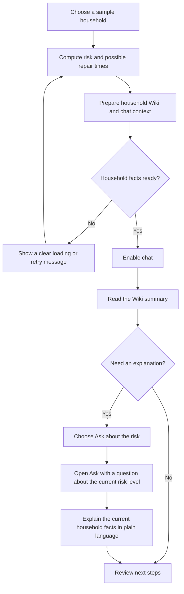
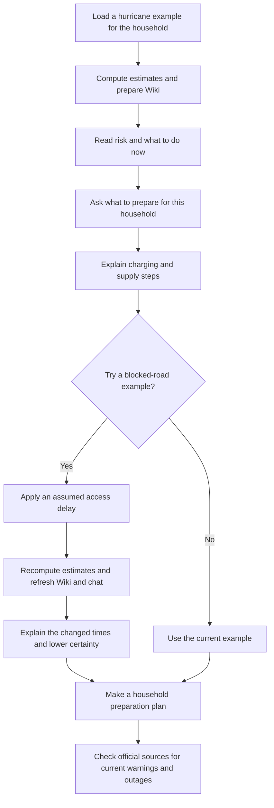
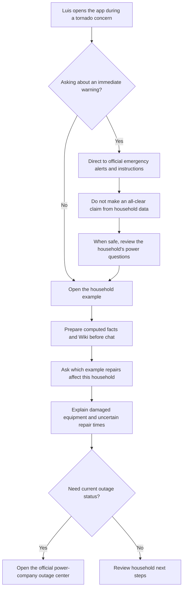
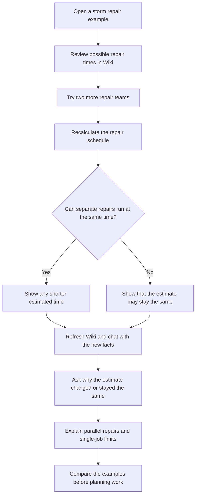
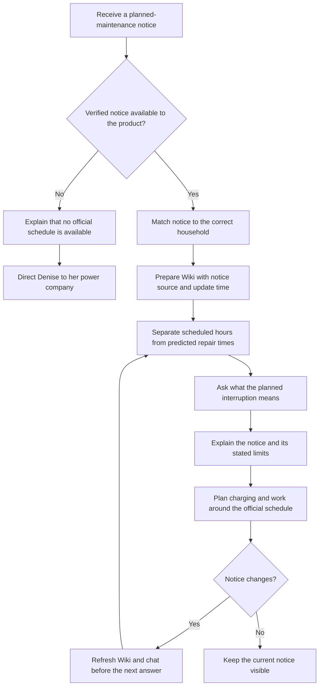
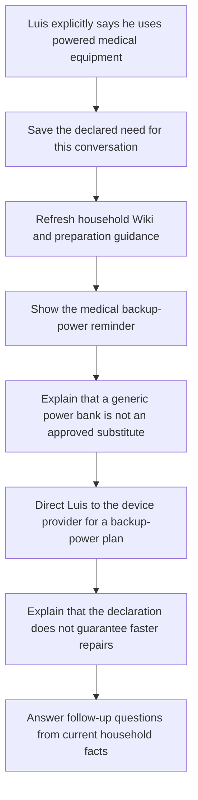
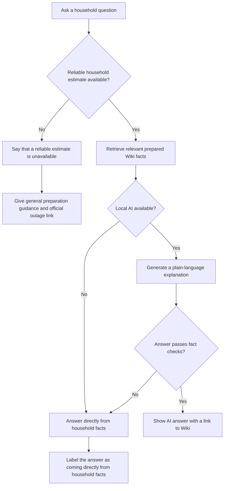
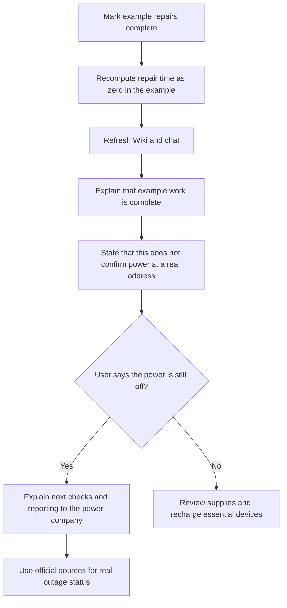
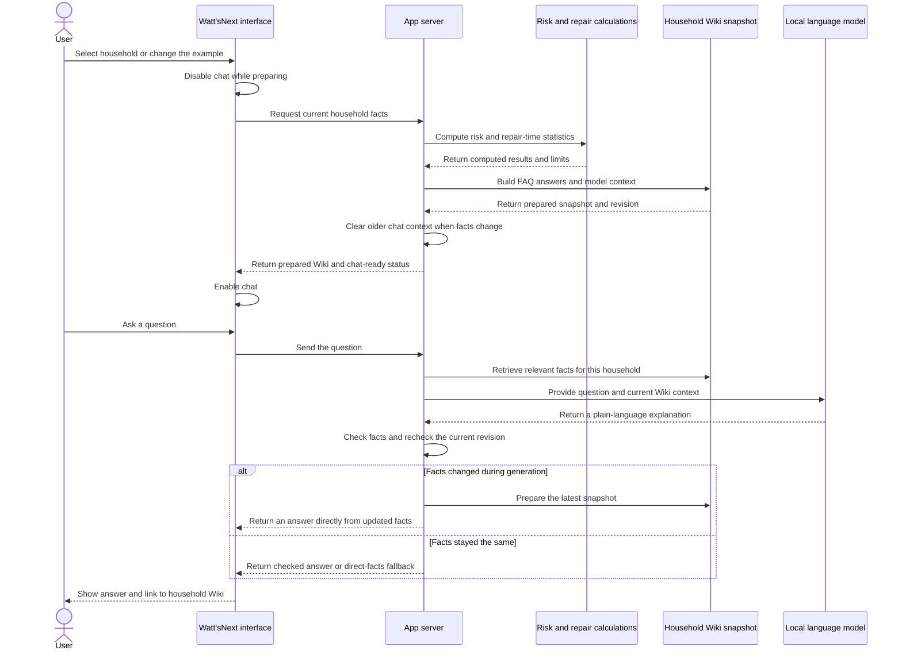

# Watt'sNext: personas, user stories, and workflows

These fictional stories show how people could use Watt'sNext to understand their household's power risk, possible repair times, and next steps. Each diagram follows a common task rather than a particular screen layout.

**Current product:** sample households, example repair scenarios, computed repair times, Wiki, Ask, Storm Activity, and local AI with a direct-facts fallback. Notifications are previews; the app does not send them. Repair times are estimates, and the current model does not provide a reliable outage percentage.

**Proposed extensions:** event-specific hurricane and tornado scenarios, verified planned-maintenance notices, and live utility updates. These are future stories, not features the current prototype already delivers. A local model still needs the app server and its data to be reachable; it does not make the website work without an internet connection.

## Fictional personas

| Persona | Household and situation | Main question | What success looks like |
|---|---|---|---|
| Maya Chen, remote customer-support worker | Lives with her partner and a child in a coastal community. Depends on her phone for work and has a power bank. | “What should I get ready, and how much work might I miss?” | A short checklist, understandable repair estimates, and an explanation of what is uncertain. |
| Luis Rivera, caregiver | Lives with his father in a rural community. His father uses powered medical equipment, which Luis explicitly tells the app about. | “What should we plan for if the power goes out?” | Clear limits on estimates and a reminder to arrange approved backup power with the device provider, without a promise of faster repairs. |
| Denise Brooks, small-business owner | Runs a home bakery in a neighborhood with overhead power lines. Plans orders around electrical equipment. | “Can I plan tomorrow's work around this interruption?” | A clear distinction between an example estimate and an official notice, plus an easy way to ask follow-up questions. |

## 1. First visit: understand this household

**Story:** As Maya, I want a simple overview before asking questions, so I can understand what the app knows about my home.

**Status:** Supported for sample households.

**Done when:** The household is clearly identified, chat becomes available only after its facts are prepared, and the risk button asks why that household has its current risk level.

## 2. Hurricane: prepare before possible outages

**Story:** As Maya, I want to understand a hurricane example and prepare my household, so I can plan charging, supplies, and work.

**Status:** Preparation and blocked-road examples exist. A hurricane-specific dataset and official warning integration are proposed.

**Example chat:** “If a road is blocked, why could repairs take longer?”

**Done when:** Maya can explain what changed in the example and knows that an assumed delay is not a measured hurricane delay or a confirmed restoration time.

## 3. Tornado: urgent safety first, outage questions later

**Story:** As Luis, I want the app to separate urgent weather safety from repair estimates, so I do not mistake a chat answer for an official warning.

**Status:** The current chat redirects requests for live information. Tornado-specific safety routing and datasets are proposed.

**Example chat:** “Does the damage in this example mean my home has lost power?”

**Done when:** Luis understands that example damage does not confirm a current outage and that the app cannot decide when a tornado threat has passed.

## 4. Severe thunderstorm: understand why more teams may not help

**Story:** As Denise, I want to compare repair examples, so I can understand why extra repair teams do not always shorten the wait.

**Status:** Supported with the existing damage examples and repair-team controls. The example is not a live thunderstorm forecast.

**Example chat:** “Why didn't adding two repair teams make this repair faster?”

**Done when:** Denise understands that teams can work on different jobs, while one repair cannot simply be divided by the number of teams.

## 5. Planned maintenance: plan around an official notice

**Story:** As Denise, I want a planned power interruption explained clearly, so I can schedule baking and contact customers early.

**Status:** Proposed. The current prototype does not ingest verified maintenance notices or know a household's planned interruption schedule.

**Example chat:** “Is this the scheduled shutoff time, or just an estimate?”

**Done when:** Official scheduled hours remain clearly distinct from predictions, and chat never invents a maintenance notice.

## 6. Medical equipment: personalize preparation without promising priority

**Story:** As Luis, I want to share a medical-equipment need, so I receive relevant preparation guidance without relying on a repair estimate for medical planning.

**Status:** Supported for explicit declarations of powered medical equipment in the current conversation.

**Example chat:** “I use a CPAP. What should I plan before an outage?”

**Done when:** Guidance uses only an explicit declaration, retains the provider-approved backup-power message, and does not change repair priority or make assumptions about health.

## 7. Missing data or unavailable AI: still give an honest answer

**Story:** As Maya, I want a useful response when the model or household data is unavailable, so I know what I can trust and what to try next.

**Status:** Supported. This is an AI-service fallback, not a promise that the website works without a network connection.

**Example chat:** “Can you still explain this if the AI is unavailable?”

**Done when:** The app does not invent missing numbers and clearly identifies when an answer comes directly from household facts.

## 8. Repairs marked complete: distinguish an example from real power

**Story:** As Denise, I want to understand what “repairs complete” means, so I do not assume my equipment has power based on an example.

**Status:** Supported as an example control; it is not a live utility restoration confirmation.

**Example chat:** “The example says repairs are done, but my power is still off. What now?”

**Done when:** An example completion never appears as a confirmed real-world restoration message.

## 9. New data arrives: keep every answer tied to the current facts

**Story:** As any household user, I want Wiki and Ask to use the same current information, so I do not receive answers from an older household or scenario.

**Status:** Supported for household selection, scenario changes, declared needs, and changes to the loaded source catalog. A live ingestion pipeline is proposed separately.

**Done when:** Computation and Wiki preparation happen before chat readiness; old facts cannot influence a new scenario's answer. The language model receives context for each question rather than being retrained every time data changes.

## Suggested walkthroughs

- **Maya:** first visit → hurricane preparation → unavailable-AI fallback.
- **Luis:** tornado information limits → explicit medical-equipment declaration → current Wiki-based questions.
- **Denise:** storm repair-team comparison → completion example → proposed planned-maintenance journey.

For a current-product demonstration, use the sample households and existing scenario controls. Present hurricane-specific, tornado-specific, and planned-maintenance flows as proposed extensions.
